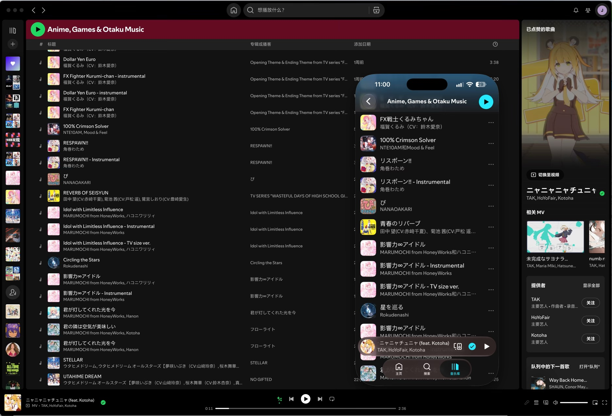
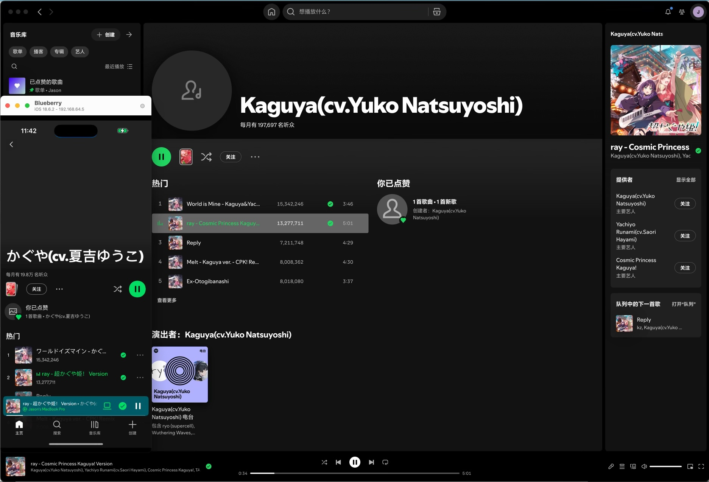

# spotify-JPOriginalTitles

An iOS plugin that restores original track, album and artist names in Spotify 9.1.88.

This repository contains prebuilt dylibs and installation instructions.

| Version | Download | Features |
| --- | --- | --- |
| v6 — current release: v6.2.1 | [JPOriginalTitles.dylib](jp-original-titles/dist/v6.2.1/JPOriginalTitles.dylib) | Original names, artist links, search, associated-album matching and maintenance controls |
| v5 | [JPOriginalTitles.dylib](jp-original-titles/dist/JPOriginalTitles.dylib) | Original names in playlists, album pages, the player bar and queue |

## Screenshots

Playlist:

Artist page:

## How it works

The plugin rewrites metadata in Spotify's networking layer without changing the Spotify main binary.

- Restores track, album and artist names in IdentityTrait and client-requested TRACK_V4 metadata, including structured title fields.
- Uses a track's canonical release when it supplies an original CJK name. Otherwise, it can follow a server-provided album association and match a unique ISRC with identical duration, disc and track number.
- Looks up artist names independently. Chinese-language CJK names take priority; Japanese fallback names must contain kanji or hiragana. Pure katakana fallback names are rejected.
- Keeps the client's artist links and applies learned names to artist entities, track contributors and search results. Playlist names remain user content.
- Handles plain and gzip metadata requests and removes old name-query etags so refreshed metadata can be rewritten.
- Processes large original-name lookups in batches with limited concurrency. Incomplete lookups return an error instead of a successful, partially processed response; later requests can retry.

Completed lookups without an unambiguous original name keep the available client value. The plugin does not guess replacements by title, change the app language or unlock region-restricted content. Korean and song-title multilingual fallback are not enabled.

## Installation

Requires Spotify iOS 9.1.88 with a plugin loader that loads `Frameworks/*.dylib`.

1. Download the current v6 dylib above.
2. Put `JPOriginalTitles.dylib` into `Payload/Spotify.app/Frameworks/` with mode 755, then repackage and install. Keep only one version of the plugin.
3. Open **Settings and privacy → Original Titles**, directly below **Eevee Settings**.

Upgrades reset only the plugin name cache. Spotify metadata, playback resume state, login, preferences, Keychain and audio files are retained.

All dylibs are arm64, require iOS 14.0 or later, and are ad-hoc signed.

## Maintenance

The English management page includes versions, hook status, cache counts, diagnostic logging, log export and log clearing.

Select the required reset checkboxes, then tap **Apply**. Spotify closes immediately; reopen it to run the selected resets.

| Reset checkbox | Effect |
| --- | --- |
| **Reset Plugin Name Cache** | Clear original-name lookups and learned artist names. |
| **Reset Spotify Metadata and Library Index** | Clear `PersistentCache/Users/*/primary.ldb` and the plugin name cache. The library resyncs online; playback resume state is retained. |
| **Reset Playback Resume State** | Delete `PersistentCache/Users/*/context_player_state_restore` directly, without a backup. Clear the saved playback queue and position. |

Spotify metadata and playback resets are optional maintenance actions and run only when explicitly selected. Login, preferences, Keychain and audio files are retained.

## Limitations

- Original-name lookup depends on server metadata and connectivity. Extra lookups can delay pages or search results; interrupted lookups can cause a loading error.
- Releases without a usable canonical or album association remain unchanged.
- Pure-katakana Japanese artist names may remain romanized, and some other locale-dependent text may retain the client name.
- Region-restricted original artist pages remain restricted; the plugin keeps the client's artist links.
- Spotify updates can change the internal classes and protocol fields used by the plugin.

## Disclaimer

Not affiliated with Spotify. For personal learning and research only. Follow your local laws and Spotify's terms of service.
